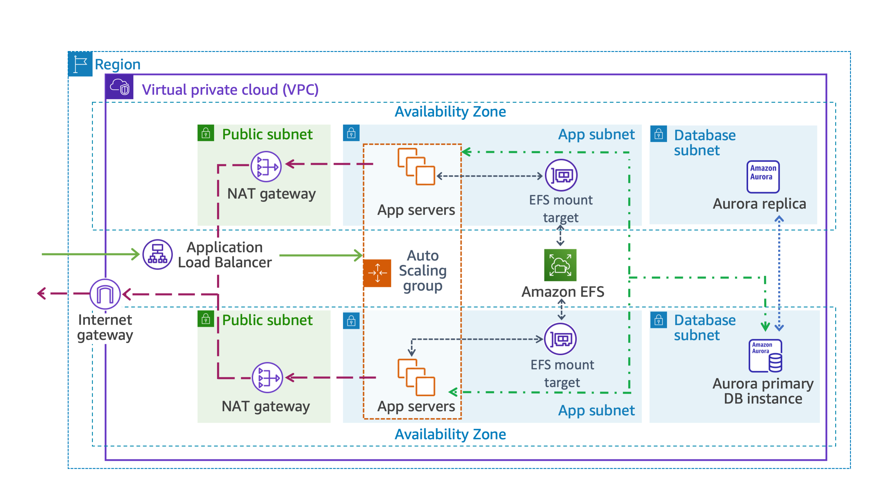
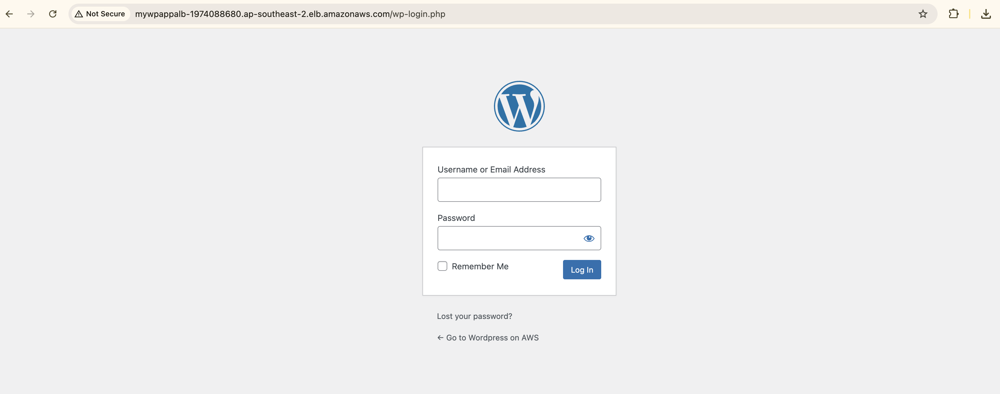

# AWS HA WordPress Architecture

Enterprise-grade, fault-tolerant multi-tier web architecture deployed on AWS using EC2 Auto Scaling, an Application Load Balancer, Amazon EFS shared storage, and an Amazon Aurora MySQL Multi-AZ cluster.

## Overview

This repository demonstrates a resilient, production-style WordPress deployment designed for high availability, fault tolerance, and horizontal scalability in a single AWS Region. The solution separates the web tier, storage layer, and database layer while maintaining a simplified deployment model suitable for enterprise workloads.

## Architecture Overview

<p align="center">
  
</p>

### Key Architectural Tenets

- High Availability & Fault Tolerance: Multi-AZ deployment across compute, storage, and database layers.
- Stateless Compute Layer: Amazon EC2 instances managed by an Auto Scaling Group run behind an Application Load Balancer.
- Decoupled Distributed Storage: Amazon EFS provides shared, multi-AZ NFS storage for application assets.
- Managed Relational Database: Amazon Aurora MySQL-compatible cluster with a Writer node and automated failover Reader replica.
- Defense-in-Depth Network Isolation: Public subnets host only the ALB and NAT gateways; application compute and databases remain in private subnets.

---

## Technology Stack & Services

| Service | Category | Function in Architecture |
| :--- | :--- | :--- |
| Amazon VPC | Networking | Custom VPC with public, app, and DB subnets across multiple AZs |
| AWS CloudFormation | IaC | Declarative infrastructure provisioning |
| Amazon Aurora (MySQL) | Database | Multi-AZ database cluster with primary writer and reader replica |
| Amazon EFS | Storage | Shared POSIX-compliant storage for WordPress assets |
| Application Load Balancer | Load Balancing | Layer 7 traffic distribution and health checks |
| EC2 Auto Scaling | Compute / Scaling | Dynamic horizontal scaling based on CPU utilization |
| AWS Systems Manager | Management | OS and configuration management |

---

## Repository Layout

```text
├── .gitignore
├── LICENSE
├── README.md
├── docs/
│   ├── architecture-diagram.png            # Architecture overview diagram
│   ├── architecture-diagram.svg            # Architecture overview diagram (vector)
│   ├── wordpress-login.png                 # Example login screen
│   └── wordpress-login.svg                 # Example login screen (vector)
├── scripts/
│   └── userdata.sh                         # Web server bootstrap and WordPress setup
└── templates/
    ├── 01-networking-infrastructure.yaml   # VPC, subnets, route tables, NAT gateways
    └── 02-launch-template.yaml             # EC2 launch template configuration
```

---

## Step-by-Step Implementation Guide

### Task 1: Network Foundation (CloudFormation)

Deploy `templates/01-networking-infrastructure.yaml` to create the VPC and network topology:

- Amazon VPC: `LabVPC`
- Subnets: `PublicSubnet1`, `PublicSubnet2`, `AppSubnet1`, `AppSubnet2`, `DBSubnet1`, `DBSubnet2`
- Internet Gateway and two NAT Gateways
- Security groups for the ALB, EC2 instances, EFS mount targets, and Aurora access

### Task 2: Multi-AZ Aurora Database

Create an Amazon Aurora MySQL cluster:

1. Open Amazon RDS > Create database
2. Choose Aurora (MySQL Compatible)
3. Set Cluster Identifier: `MyDBCluster`
4. Set Master Username: `admin`
5. Set Database Name: `WPDatabase`
6. Select a `db.t3.medium` instance class
7. Enable a Reader node in a different AZ
8. Use VPC `LabVPC` and database subnets only
9. Disable public access and attach `RDSSecurityGroup`
10. Record the Writer Endpoint for later configuration

### Task 3: Amazon Elastic File System (EFS)

Create the shared EFS file system:

1. Go to Amazon EFS > Create file system
2. Name the filesystem: `myWPEFS`
3. Use General Purpose performance mode and Bursting throughput
4. Add mount targets in `AppSubnet1` and `AppSubnet2`
5. Attach `EFSMountTargetSecurityGroup`
6. Record the resulting file system ID (`fs-xxxxxxxx`)

### Task 4: Application Load Balancer & Target Group

Configure the ALB and target group:

- Target group: `myWPTargetGroup`
  - Target type: `Instances`
  - Protocol/Port: `HTTP:80`
  - VPC: `LabVPC`
  - Health check path: `/wp-login.php`
- ALB: `myWPAppALB`
  - Internet-facing, IPv4
  - Subnets: `PublicSubnet1` and `PublicSubnet2`
  - Listener: Forward port 80 to `myWPTargetGroup`
- Save the ALB DNS name

### Task 5: Launch Template Configuration

Deploy `templates/02-launch-template.yaml` to configure the EC2 launch template. Supply:

- `DBName`: `WPDatabase`
- `Databaseendpoint`: Aurora Writer Endpoint
- `DatabaseUserName`: `admin`
- `DatabasePassword`: database password
- `ALBDnsName`: ALB DNS name
- `WPElasticFileSystemID`: EFS file system ID

### Task 6: EC2 Auto Scaling Group

Create an Auto Scaling Group in EC2:

- Name: `WP-ASG`
- Launch template: `LabLaunchTemplate`
- VPC: `LabVPC`
- Subnets: `AppSubnet1` and `AppSubnet2`
- Attach to the existing target group: `myWPTargetGroup`
- Enable ELB health checks and CloudWatch metrics
- Desired: `2`, Minimum: `2`, Maximum: `4`
- Scaling policy: target tracking on average CPU utilization at `50%`

---

## User Data Script

The bootstrap script used by the EC2 instances is located at `scripts/userdata.sh`.

```bash
#!/bin/bash
set -e

# Update OS and install dependencies
yum update -y
yum install -y httpd php php-mysqlnd php-gd php-xml php-mbstring amazon-efs-utils

# Enable and start Apache
systemctl start httpd
systemctl enable httpd

# Mount Amazon EFS
mkdir -p /var/www/html
mount -t efs -o tls ${WPElasticFileSystemID}:/ /var/www/html
echo "${WPElasticFileSystemID}:/ /var/www/html efs _netdev,tls 0 0" >> /etc/fstab

# Install WordPress if not already configured
if [ ! -f /var/www/html/wp-config.php ]; then
  cd /var/www/html
  wget https://wordpress.org/latest.tar.gz
  tar -xzf latest.tar.gz --strip-components=1
  rm -f latest.tar.gz

  cp wp-config-sample.php wp-config.php
  sed -i "s/database_name_here/${DBName}/" wp-config.php
  sed -i "s/username_here/${DBUser}/" wp-config.php
  sed -i "s/password_here/${DBPassword}/" wp-config.php
  sed -i "s/localhost/${DBEndpoint}/" wp-config.php

  chown -R apache:apache /var/www/html
fi

systemctl restart httpd
```

---

## Verification & Testing

### 1. Target Health Validation

Open EC2 > Target Groups > `myWPTargetGroup` and confirm both instances are healthy.

### 2. Live Application Access

Open the following URL in a browser:

```text
http://<ALB-DNS-NAME>/wp-login.php
```

<p align="center">
  
</p>

Log in using the `wpadmin` account and your administrator password to access the WordPress admin dashboard.

---

## Summary

This repository demonstrates how to design and deploy a resilient multi-tier WordPress architecture on AWS using VPC isolation, load-balanced stateless web servers, shared EFS storage, and an Aurora MySQL database cluster.

It is intentionally aligned with enterprise cloud architecture patterns for availability, scalability, and operational resilience.
